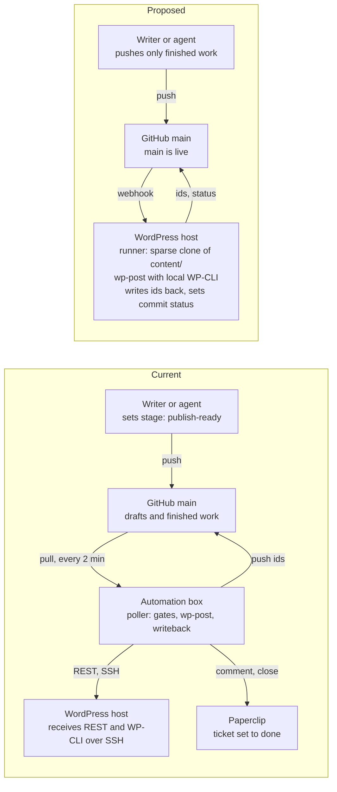

# wp-post publishing: current vs proposed

2026-10-26 - Adam Marash

Live doc: https://claude.ai/artifact/9gHANRVvQCGVS3BYEBxdxQ

The proposal retires the automation-box poller: a push to `main` becomes the
publish, and a runner on the WordPress host pulls only the content and runs
wp-post there, with WP-CLI local.

## At a glance

Today a publish crosses GitHub, the automation box, the WordPress host and
Paperclip. In the proposal, GitHub calls the WordPress host, and the host does
all the work itself.

## Current: the poller on the automation box

Today a commit is not a publish. Agents and people commit to `main` at every
editorial stage, and a poller on the automation box decides what ships. This
describes payperfax-content, the most complex repo; simpler repos run wp-post
by hand.

1. An agent or a person sets `stage: publish-ready` on an item and pushes to
   `main`.
2. The automation box pulls the repo about every 2 minutes.
3. `tools/publish_poll.py` (systemd timer, every 2 minutes) finds
   `publish-ready` items and runs the gates: fact-check verdict, tone verdict,
   and a `_drafts/changes.yaml` entry dated today.
4. It runs wp-post, which posts over the REST API and links MSLS translations
   by running WP-CLI over SSH (`@payperfax` alias).
5. It runs extra WP-CLI steps over SSH: the aggregation taxonomy and the
   top-ten snippet.
6. wp-post writes `id` and `slug` back into the front matter; the poller sets
   `stage: published`, reindexes, commits and pushes.
7. It checks that the live URL returns 200.
8. It comments on the item's Paperclip ticket (`paperclip_issue:`) and sets it
   to done, through the Paperclip API on the automation box. A failure is
   posted to the ticket instead.

Edits to live pages without a stage change do not ship. That is on purpose,
and the daily drift job reports them.

## Proposed: push to main is the publish

Whatever reaches `main` goes live. The gate moves from the poller to the push,
and the work moves from the automation box to the WordPress host.

1. An agent or a person pushes finished content to `main`. Work in progress
   stays off `main`.
2. GitHub calls a webhook listener on the WordPress host. A cron job that runs
   `git fetch` every minute can stand in for it (open question).
3. The runner pulls into a sparse clone that holds only `content/`, outside
   the web root (`/sites/<domain>/repo/`). No other directory of the repo
   reaches the server.
4. It runs wp-post on the changed items, as the site user. REST posting, MSLS
   linking, the taxonomy and snippet steps and the cache purge all use local
   WP-CLI: no SSH, no alias.
5. For a new item, it writes the new `id` back, commits and pushes to GitHub.
   The runner skips its own commits (marked in the message), so the writeback
   does not publish the item a second time.
6. It reports the result as a GitHub commit status on the pushed commit:
   green, or red with the wp-post error.

Writers must pull before they edit an item again, so they have the `id` the
runner wrote.

## Side by side

| Aspect                      | Current                                          | Proposed                                                  |
|-----------------------------|--------------------------------------------------|-----------------------------------------------------------|
| Trigger                     | Poller timer, every 2 min                        | Push to `main` (webhook, or 1-min cron)                   |
| Time to live                | 2 to 4 min                                       | Seconds (webhook) or up to 1 min (cron)                   |
| What ships                  | `stage: publish-ready` items that pass the gates | Items changed in the push                                 |
| Where the gate lives        | In the poller                                    | Before the push: only finished work reaches `main`        |
| Where wp-post runs          | Automation box                                   | WordPress host, as the site user                          |
| MSLS and other WP-CLI steps | SSH to the host, `@payperfax` alias              | Local WP-CLI                                              |
| Repo on the WP host         | None                                             | Sparse clone of `content/` only, outside the web root     |
| ID writeback                | Poller commits and pushes from the box           | Runner commits and pushes from the host                   |
| Push access to GitHub       | Automation box                                   | WordPress host (write deploy key)                         |
| Error reporting             | Comment on the Paperclip ticket                  | GitHub commit status on the pushed commit                 |
| Paperclip ticket close      | Automatic                                        | None, unless added (open question)                        |
| Python and deps             | Already on the box                               | `uv` in the site user's home (no pip or venv on the host) |
| Machines involved           | GitHub, automation box, WP host                  | GitHub, WP host                                           |

## What has to change

The largest change is editorial, not technical: `main` must hold only work
that is ready to go live.

- [ ] **Keep work in progress off `main`.** Either drafts live on branches and
  a merge is the publish, or the runner publishes a changed item only when it
  has no `stage:` or has `stage: publish-ready`. Without one of these, a push
  at the `brief` stage publishes a brief, and a typo fix ships any older
  unpublished edit in the same file.
- [ ] **Runner on the WP host.** Sparse clone outside the web root, the
  webhook listener or cron job, a record of the last published commit, and a
  lock so two runs never overlap.
- [ ] **Python on the host.** Install `uv` in the site user's home; it brings
  its own Python packages without root.
- [ ] **Host config.** A `.wp-poster.json` on the host (gitignored, never in
  the repo) with the app password and a WP-CLI target that works locally, not
  `@payperfax`.
- [ ] **Write access from the host.** A deploy key that can push, plus branch
  protection, because a hacked WordPress site could then push to the repo. The
  runner rebases before it pushes and stops on a conflict instead of retrying.
- [ ] **Error reports.** A GitHub token on the host for commit statuses.
- [ ] **Turn off the poller** on the automation box once the runner has
  published cleanly for a while.

## Changes to wp-post

Most of the runner belongs in wp-poster, so every content repo gets the same
behaviour and no repo scripts its own.

| Change                    | What it does                                                                                                                                                           | Needed for                       |
|---------------------------|------------------------------------------------------------------------------------------------------------------------------------------------------------------------|----------------------------------|
| Publish changed items     | One command publishes the items changed between two commits, using the network `content_path` map and skipping `_`-prefixed folders.                                   | Every repo                       |
| Selection rule in config  | `.wp-poster.json` says whether a changed item needs no `stage:` or `stage: publish-ready` to ship.                                                                     | Repos that keep drafts on `main` |
| Shipped runner            | A `wp-post-runner` script in wp-poster: fetch, lock, publish changed items, commit the writeback, push, set the commit status.                                         | Every repo                       |
| Skip own commits          | The runner marks its writeback commits and ignores them on the next run.                                                                                               | Every repo                       |
| Post-publish hook         | A command in config that runs after each publish with the post id, URL and file. The aggregation taxonomy and top-ten snippet move there and stay in the content repo. | payperfax                        |
| Deleted and renamed files | A rename keeps the post (the `id` moves with the file). A delete does nothing to WordPress and is reported.                                                            | Every repo                       |

What stays as it is:

- **ID writeback.** MSLS sibling search, `drift-report.py` and
  `verify-live-meta.py` all read `id` from the files, so lookup by file path
  does not replace it.
- **The WP-CLI target.** An `@alias` in the site user's `~/.wp-cli/config.yml`
  that points at the local install should work for both MSLS linking and
  `--purge` with no code change. To test.
- **JSON output.** The poller already reads wp-post's success JSON; the runner
  uses the same.
- **Install on the host.** A git checkout of wp-poster in the site user's
  home, run with `uv`; a third host type beside the dev box and the automation
  box.

## SpinupWP: what we use and what we don't

We use the site user SpinupWP already gives each site, and none of its deploy
features.

**We use:**

- **The site user.** It owns the WordPress files, and the site's PHP pool runs
  as it, so the runner, cron and a webhook route all run WP-CLI locally.
- **What the server already has:** git, WP-CLI, Python 3, plus `uv` installed
  in the site user's home.
- **A real domain with SpinupWP's Let's Encrypt certificate.** The temporary
  `*.spinupwp.site` domain fails certificate checks.
- **The webhook endpoint, if we choose a listener:** a small REST route in a
  mu-plugin that checks GitHub's signature and starts the runner in the
  background.

**We don't use:**

- **Git deploy or push-to-deploy for content.** It checks the repo out into
  the web root and takes the site's one git slot. That slot stays free for
  plugin deploys.
- **A moved public folder.** Not needed once the clone lives outside `files/`.
- **SpinupWP's deploy key** (`~/.ssh/git_rsa`). The runner gets its own key,
  scoped to the content repo, with push access.
- **Anything that needs root.** No `apt` packages and no server-wide config;
  the site user has no sudo.

## Options set aside

| Option                                           | Why not                                                                                                                                                                                                               |
|--------------------------------------------------|-----------------------------------------------------------------------------------------------------------------------------------------------------------------------------------------------------------------------|
| GitHub Actions runs wp-post                      | MSLS linking and purge need SSH and WP-CLI on the runner; new IDs must be committed back from CI.                                                                                                                     |
| A PHP plugin replaces wp-post on the site        | Ports about 4,450 lines of Python (converter, callouts, bookmark cards, image hashing) and leaves two versions to keep in step.                                                                                       |
| SpinupWP git deploy with push-to-deploy          | Checks the whole repo out into `files/`, the web root, so `intelligence/`, `_docs/` and the rest become public; only dot directories are blocked. Also takes the site's one git slot, which plugin deploys could use. |
| SpinupWP git deploy with the public folder moved | Fixes exposure, but each existing site must move WordPress into the new folder, and payperfax-content already tracks a `public/` directory.                                                                           |

SpinupWP git deploy still fits the plugin sources in `wp-mu-plugins/` and
`wp-plugins/`, which are deployed by hand today.

## Tested so far

On a SpinupWP test site (single site, WordPress 7.1.3), on 2026-10-26:

| Check                                    | Result                                                           |
|------------------------------------------|------------------------------------------------------------------|
| Site user runs WP-CLI on its own install | Works, no SSH needed                                             |
| `git`, `python3` on the host             | Present (Python 3.12)                                            |
| pip or venv for the site user            | Missing; no sudo, so `uv` it is                                  |
| A file in `files/content/`               | Served to anyone (200)                                           |
| A file in `files/.content/`              | Blocked (403)                                                    |
| Temporary `*.spinupwp.site` domain       | Certificate not trusted, so REST calls fail; needs a real domain |

## Open questions

- [ ] Webhook listener or 1-minute cron? Cron is less code; the listener only
  saves up to a minute.
- [ ] Branches or a `stage:` check to keep unready work off `main`?
- [ ] After a publish, must the Paperclip ticket still close? If yes, the WP
  host needs a way to reach the Paperclip API.
- [ ] MSLS linking from the host: test on a multisite network with MSLS.
- [ ] Can the site user keep a crontab on SpinupWP, and is there a time limit
  on long runs?
- [ ] Does a local `@alias` in the site user's `~/.wp-cli/config.yml` work for
  both MSLS linking and `--purge`?
